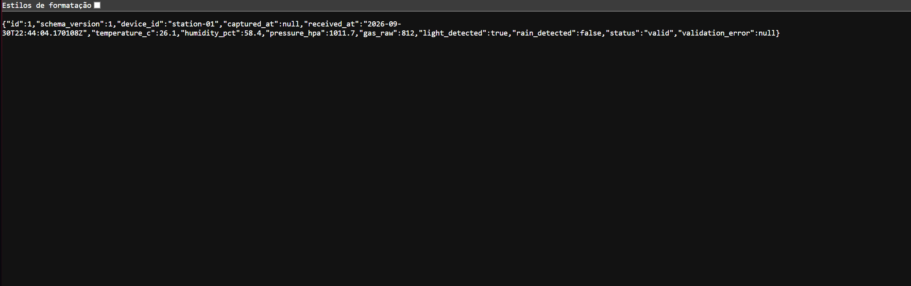

# Software da estação meteorológica

Este diretório reúne a parte de software da estação meteorológica. O backend recebe uma leitura por MQTT, confere o JSON, grava os dados no SQLite e permite consultá-los pela API.

```text
Publicador MQTT → Mosquitto → assinante Python → Pydantic → SQLite → FastAPI
```

Enquanto o firmware não está integrado, usamos `mosquitto_pub` para enviar uma leitura de teste. Depois, o ESP32 ocupará o lugar desse comando; o restante do fluxo continuará o mesmo.

## O que já funciona

- broker Mosquitto validado localmente;
- assinante MQTT 3.1.1 com Paho MQTT;
- configuração externa por `.env`;
- validação do payload com Pydantic;
- classificação de leituras como `valid` ou `partial`;
- rejeição observável de mensagens inválidas sem interrupção do serviço;
- persistência SQLite com horário de recebimento em UTC;
- API para saúde, leitura atual, histórico e consulta por ID;
- testes automatizados com bancos descartáveis;
- teste integrado local do fluxo completo.

Ainda falta testar com o hardware:

- publicação pelo ESP32;
- leitura dos sensores físicos;
- comunicação pelo hotspot;
- acesso de outro dispositivo ao broker e à API;
- queda e reconexão real do broker;
- calibração ou precisão física dos sensores.

O contrato MQTT permanece provisório até a revisão de Gabriel.

## Requisitos

- Windows;
- Python 3.12 ou compatível;
- `uv`;
- Eclipse Mosquitto 2.1.2 ou compatível.

O Mosquitto pode ser instalado pelo WinGet:

```powershell
winget install --id EclipseFoundation.Mosquitto --exact
```

Confira se o serviço está em execução:

```powershell
Get-Service mosquitto
```

## Preparar o projeto

Abra o PowerShell na pasta `software` e instale as dependências:

```powershell
uv sync
```

Crie a configuração local a partir do exemplo:

```powershell
Copy-Item .env.example .env
```

O `.env` não é versionado. Não adicione senhas, IPs pessoais ou credenciais ao Git.

### Configurações disponíveis

| Variável | Valor de exemplo | Finalidade |
|---|---|---|
| `MQTT_HOST` | `127.0.0.1` | Endereço do broker |
| `MQTT_PORT` | `1883` | Porta MQTT |
| `MQTT_TOPIC` | `weather/station-01/readings` | Tópico das leituras |
| `MQTT_QOS` | `1` | Qualidade de serviço MQTT |
| `MQTT_KEEPALIVE` | `60` | Intervalo de keepalive em segundos |
| `WEATHER_DATABASE_PATH` | `data/station.db` | Caminho do banco SQLite |

Para uma execução descartável da S2, pode ser usado `WEATHER_DATABASE_PATH=data/s2-demo.db`.

## Executar o sistema

Use dois terminais na pasta `software`, ambos com a mesma configuração `.env`.

No primeiro terminal, inicie o assinante MQTT:

```powershell
uv run python -m app.mqtt_subscriber
```

No segundo terminal, inicie a API:

```powershell
uv run uvicorn app.main:app --reload
```

O banco e a tabela `readings` são inicializados automaticamente. Também é possível inicializá-los manualmente:

```powershell
uv run python -m app.database
```

## Endpoints

| Método e rota | Resultado |
|---|---|
| `GET /health` | Confirma que a API está em execução |
| `GET /api/v1/readings/latest` | Retorna a leitura `valid` ou `partial` mais recente |
| `GET /api/v1/readings?limit=100` | Retorna o histórico do mais recente para o mais antigo |
| `GET /api/v1/readings/{id}` | Retorna uma leitura específica |

O histórico aceita `limit` de 1 a 500. Banco vazio retorna uma lista vazia no histórico e HTTP 404 na consulta da leitura mais recente.

## Comprovar o fluxo MQTT

Com Mosquitto, assinante e API em execução, abra um terceiro terminal na pasta `software`.

### Mensagem válida

```powershell
$validPayload = '{"schema_version":1,"device_id":"station-01","captured_at":null,"temperature_c":26.1,"humidity_pct":58.4,"pressure_hpa":1011.7,"gas_raw":812,"light_detected":true,"rain_detected":false}'
$validPayload | & 'C:\Program Files\mosquitto\mosquitto_pub.exe' -h 127.0.0.1 -p 1883 -t 'weather/station-01/readings' -q 1 -s
```

O conteúdo é enviado pela entrada padrão (`-s`) para o Windows PowerShell preservar as aspas do JSON.

Consulte a leitura recebida:

```powershell
Invoke-RestMethod 'http://127.0.0.1:8000/api/v1/readings/latest'
Invoke-RestMethod 'http://127.0.0.1:8000/api/v1/readings?limit=10'
```

### Mensagem parcial

`gas_raw: null` representa um sensor temporariamente indisponível:

```powershell
$partialPayload = '{"schema_version":1,"device_id":"station-01","captured_at":null,"temperature_c":26.2,"humidity_pct":58.1,"pressure_hpa":1011.6,"gas_raw":null,"light_detected":true,"rain_detected":false}'
$partialPayload | & 'C:\Program Files\mosquitto\mosquitto_pub.exe' -h 127.0.0.1 -p 1883 -t 'weather/station-01/readings' -q 1 -s
```

A leitura deve aparecer na API com `status: "partial"`.

### Mensagem inválida

Umidade acima de 100 deve ser rejeitada:

```powershell
$invalidPayload = '{"schema_version":1,"device_id":"station-01","captured_at":null,"temperature_c":26.3,"humidity_pct":150,"pressure_hpa":1011.5,"gas_raw":820,"light_detected":true,"rain_detected":false}'
$invalidPayload | & 'C:\Program Files\mosquitto\mosquitto_pub.exe' -h 127.0.0.1 -p 1883 -t 'weather/station-01/readings' -q 1 -s
```

O assinante registra o motivo no log, a mensagem não entra no histórico e a API continua respondendo:

```powershell
Invoke-RestMethod 'http://127.0.0.1:8000/health'
```

### Resultado visto na API



*Leitura fictícia publicada manualmente para testar o fluxo. A imagem não representa dados dos sensores físicos.*

## Executar os testes

```powershell
uv run pytest
```

Os testes criam bancos temporários. Eles não utilizam nem alteram `data/station.db`.

## Estrutura principal

```text
software/
├── app/
│   ├── database.py
│   ├── main.py
│   ├── models.py
│   ├── mqtt_subscriber.py
│   ├── repository.py
│   └── settings.py
├── docs/
│   └── evidencias-s2.md
├── tests/
├── .env.example
├── pyproject.toml
└── uv.lock
```

## Unidades e limites

- `temperature_c`: graus Celsius;
- `humidity_pct`: porcentagem entre 0 e 100;
- `pressure_hpa`: hectopascal;
- `gas_raw`: valor bruto, não representa ppm;
- `light_detected`: estado digital normalizado, não representa lux;
- `rain_detected`: presença de água normalizada, não representa milímetros.

As evidências técnicas da S2 estão em [docs/evidencias-s2.md](docs/evidencias-s2.md).
